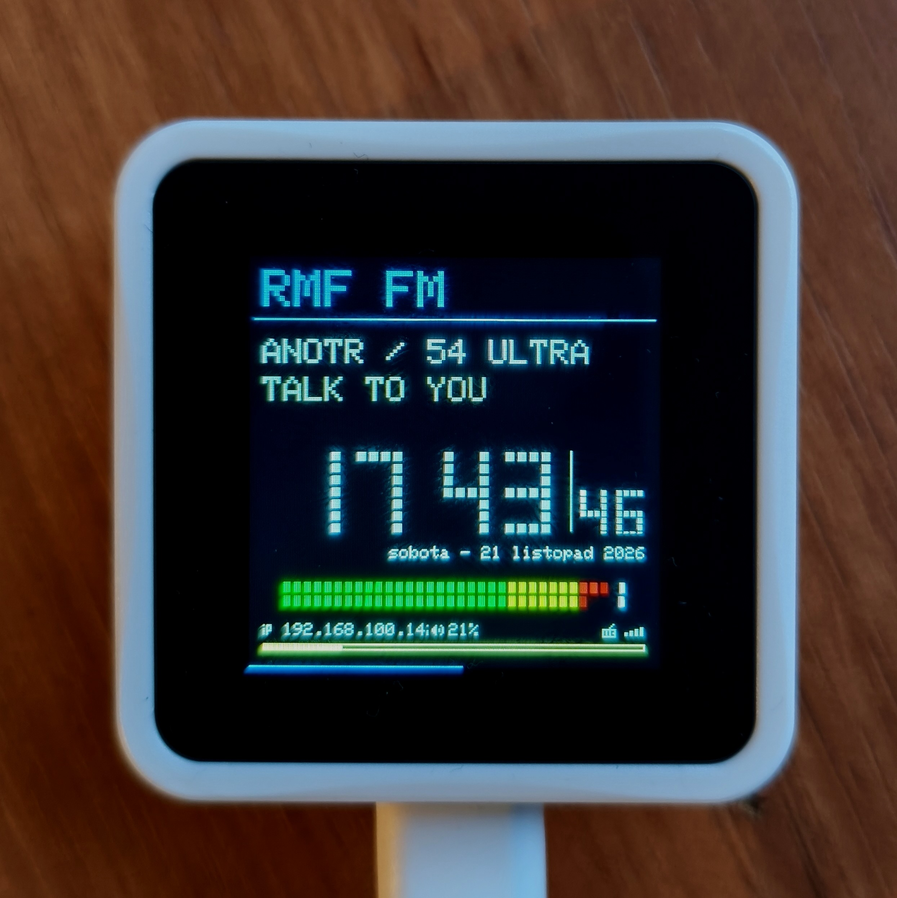
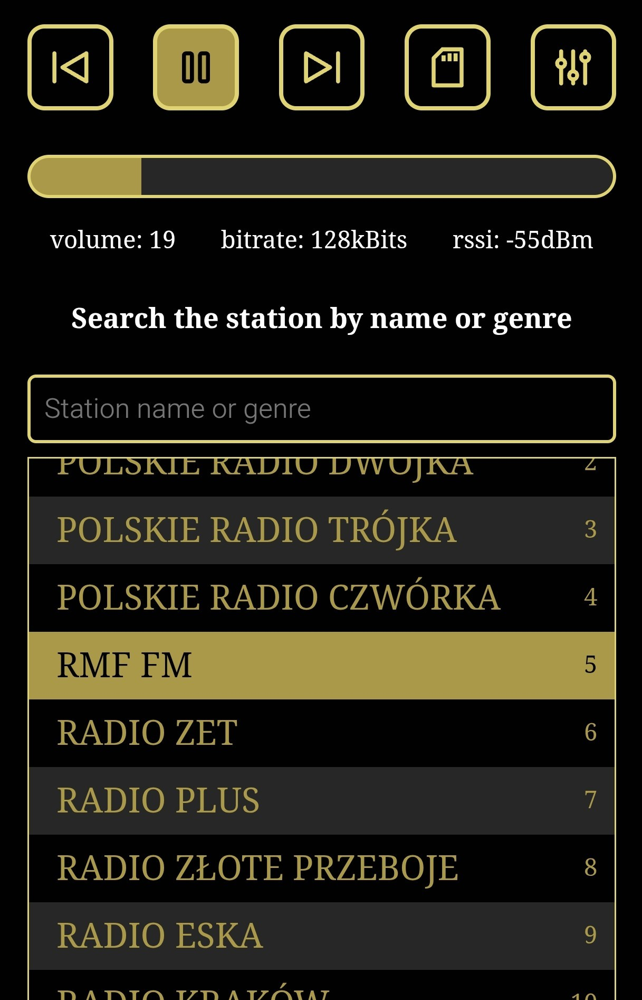
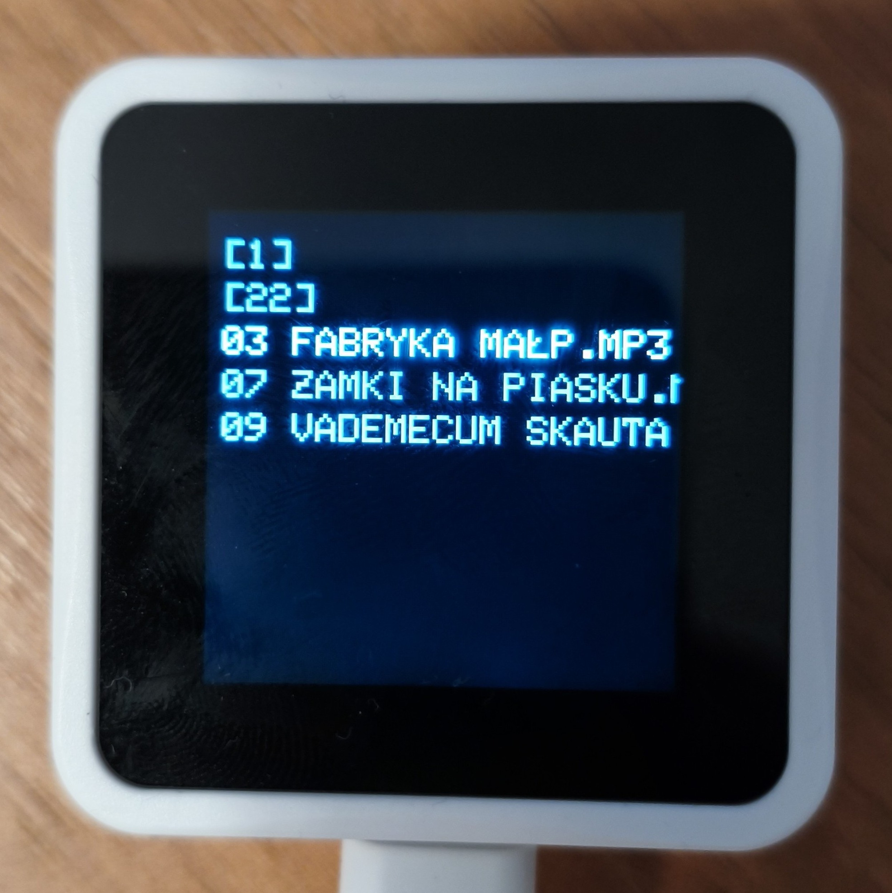
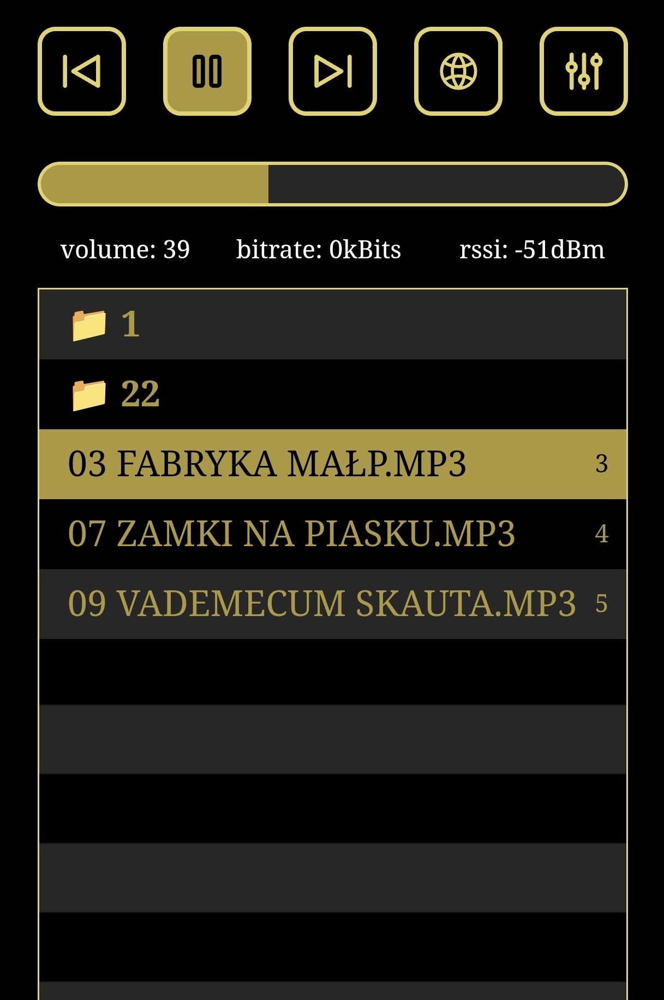

# yoRadio on Waveshare ESP32-S3-Touch-LCD-1.54

<p align="center">Radio</p>
<p align="center">
  
  
</p>
<p align="center">Player SD</p>
<p align="center">
  
  
</p>


**[English](#english) | [Polski](#polski)**

# English

This project is a fork of [VaraiTamas/yoRadio](https://github.com/VaraiTamas/yoRadio) (version 0.8.8)
adapted to the **Waveshare ESP32-S3-Touch-LCD-1.54** board (SKU 33868).
The board pins and drivers come from the manufacturer's repository:
[waveshareteam/ESP32-S3-Touch-LCD-1.54](https://github.com/waveshareteam/ESP32-S3-Touch-LCD-1.54).


## Hardware

| Component | Chip | Pins |
|---|---|---|
| 1.54" 240x240 display | ST7789 (SPI) | SCK 38, MOSI 39, DC 45, CS 21, RST 40, backlight 46 |
| Touch | CST816 (I2C 0x15) | SDA 42, SCL 41, INT 48, RST 47 |
| Audio codec | ES8311 (I2C 0x18) | SDA 42, SCL 41 (I2C bus shared with touch), MCLK 8, BCLK 9, LRC 10, DOUT 12 |
| Amplifier | PA_CTRL | GPIO 7 |
| Battery power hold | | GPIO 2 (HIGH) |
| Case buttons | | left GPIO 0 (BOOT), middle GPIO 5 (PWR), right GPIO 4 |
| microSD card | SDMMC 4-bit (SD_MMC) | CLK 16, CMD 15, D0 17, D1 18, D2 13, D3 14 |

Module: ESP32-S3, 16 MB flash, 8 MB PSRAM (OPI). It matches the `esp32-s3-devkitc1-n16r8` environment
in `platformio.ini`.

The board also has a QMI8658 sensor and battery measurement (ADC GPIO 1, charging GPIO 3). yoRadio does not use them.

## What was changed

All board-related changes are enabled by a single switch in `myoptions.h`:

```c
#define BOARD_WS_S3_TOUCH_LCD_154
```

### `myoptions.h`
- Set the board, the `DSP_ST7789_240` display (instead of the `DSP_SSD1322` OLED) and the display, touch and I2S pins
  from the table above.
- Added `I2S_MCLK 8`, because the ES8311 codec needs an MCLK clock from the ESP32.
- `MUTE_PIN 7` / `MUTE_VAL LOW` turns the amplifier on during playback and off after stopping.
- Buttons arranged to match the case: `BTN_LEFT 0`, `BTN_CENTER 5`, `BTN_RIGHT 4`.
- Both encoders disabled, because their pins conflicted with the board.
- `ENCODERS_INDEPENDENT` commented out. This option blocked switching the station list by holding a button.
- Interface language, name days and time announcements changed from HU to PL.
- microSD card enabled: `SDC_CS 14` and `SD_SDMMC_PINS 16, 15, 17, 18, 13, 14` (CLK, CMD, D0, D1, D2, D3, following
  the Waveshare `07_sd_card_test` example). The slot is wired to the native SDMMC interface, so the card works through
  the SD_MMC library in 4-bit mode. If that fails, the program tries 1-bit mode. `SDC_CS` is only used here to
  enable card support. The first version used SPI mode (`SD_SPIPINS`), but the card initialised with errors
  (`APP_OP_COND failed`, `f_mount failed`) and the radio froze after switching to the card. Because the radio remembers
  the selected mode, it then froze on every boot until the card was removed.
- `src/core/sdmanager.h`, `src/core/sdmanager.cpp`: when `SD_SDMMC_PINS` is defined, `SDManager` inherits from
  `fs::SDMMCFS` (SD_MMC) instead of `fs::SDFS` (SD over SPI), and `start()` sets the pins and mounts the card through SD_MMC
  (20 MHz). Without this option it works as before over SPI.

### Board initialisation: `src/boards/ws_s3_lcd154/` (new directory)
- `ws_s3_lcd154.cpp` implements `yoradio_on_setup()`, called at the start of `setup()`. The function:
  - sets GPIO 2 high (battery power hold; has no effect when powered from USB),
  - starts I2C on pins 42/41,
  - starts the display SPI on pins 38/39 before the Adafruit library does,
  - initialises the ES8311 codec: MCLK from the pin at a 256x ratio, 16-bit I2S, hardware volume 85 %
    (`WS154_CODEC_VOLUME`), microphone off.
- `es8311.cpp/.h`, `es8311_reg.h` are the Espressif ES8311 driver (Apache-2.0), copied from the Waveshare examples.
  In the header `driver/i2c.h` was replaced with `hal/i2c_types.h`.

### ST7789 240x240 display
- `src/displays/dspcore.h` got a new branch for `DSP_ST7789_240`. This fork previously supported only the 320x240 ST7789.
- `src/displays/displayST7789.h` includes the 240x240 configuration.
- `src/displays/conf/displayST7789_240conf.h` (new file) is the screen layout for 240x240. It is based on
  `displayST7789conf.h` from the fork and `displayST7789_240conf.h` from [e2002/yoradio](https://github.com/e2002/yoradio).
- `src/displays/displayST7789.cpp`:
  - on this board colours are inverted by default, as in `DSP_ST7789_170`, so that they display correctly;
  - the screen is rotated 180° by default to match its position in the case. The "flip screen" option in the web settings
    restores 0° orientation.
  - The image offset in ST7789 memory stays at the Adafruit library default. A different setting shifted the image
    by 80 px.
- `platformio.ini`: added the `adafruit/Adafruit ST7735 and ST7789 Library` library.
- Polish characters on screen: `copy_glcdfont.py` (in `platformio.ini` as `extra_scripts = pre:...`) copies the 5x7
  font from `locale/glcdfont/PL, SK, DE, RO, S, A/glcdfont.c` into the Adafruit GFX library in `.pio/libdeps` before
  every build. `utf8Pol.cpp` maps ą, ę, ł etc. to characters of this font, and the stock GFX font showed other symbols
  in their place. The original yoRadio says to copy this file by hand, and the copy disappears when the libraries are
  reinstalled.
- Station name without Polish diacritics while playing: many stations send the name without Polish letters in the
  stream metadata (`icy-name`, `StreamTitle`), e.g. "Radio PLONSK 93,6 FM", although the playlist says "Radio Płońsk".
  After STOP the screen went back to the playlist name, which is why the diacritics were visible then.
  `Config::setTitle()` and `Config::setStation()` in `src/core/config.cpp` now check whether the stream text starts
  with the playlist name written without diacritics (case-insensitive). If it does, that beginning is replaced with the
  playlist name and the rest is kept: "Radio Płońsk 93,6 FM". Other stream texts (e.g. a station description without
  diacritics) cannot be corrected.

### CST816 touch
- `src/core/options.h`: new constant `TS_MODEL_CST816 4`.
- `src/core/touchscreen.cpp` has a new driver. After reset (pin 47) it disables the chip's auto-sleep and every 20 ms
  reads registers 0x02–0x06 (finger count, X, Y). Coordinates rotate together with the screen, so touch is also
  rotated 180° by default. The "flip touch" option restores it.
- `src/core/config.cpp`: for CST816, I2C is initialised and the bus is scanned. The boot log shows the addresses
  found, e.g. 0x15 and 0x18.

### Audio
- `src/core/options.h`: new option `I2S_MCLK` (default -1, unused).
- `src/core/player.cpp` passes `I2S_MCLK` to `setPinout()`. The audio library generates MCLK = 256 x fs.

### Web page
- `data/www/style.css.gz`: on a phone (width up to 480 px) the station list in the player has a fixed height
  (60 % of the screen, min. 260 px), and the whole page scrolls. Previously the list only got the remaining space
  and shrank, even to a single item, when the song title wrapped to another line.
- `data/www/player.html.gz`: the gap below the station search field reduced from 90 px to 8 px. The genre drop-down
  is shown over the station list, so it does not need reserved space.
- `data/www/script.js.gz`: when no station in `playlist.csv` has a genre (4th column), the genre drop-down is
  hidden, and the field's label and hint only mention searching by name. After genres are added the filter
  comes back automatically.

- `data/www/style.css.gz`: long names without spaces (e.g. a stream URL instead of a station name) wrap to the next
  line. Previously they stretched the page on a phone to about 800 px width, so the whole page was scaled down
  and the icons changed size. On touch screens buttons no longer stay highlighted after a tap.
- `data/www/style.css.gz`: on a phone (up to 480 px) the player's side margins reduced from 40 px to 16 px
  on each side, so the buttons and the station list are wider. The minimum page width reduced from 333 px to
  300 px, so on 320 px screens the page no longer scrolls sideways. The search field uses a 16 px font, and the
  genre drop-down is taller (up to half the screen instead of 80 px, i.e. about two items) and has larger
  tap targets.
- `data/www/style.css.gz`: on a phone (up to 600 px) the playlist editor opens full screen, and each station is
  a card: number, checkbox, name and preview in the first row, URL in the second, volume and genre in the third.
  Previously the editor was an 880 px wide table, scrolled sideways, with a hidden close button. The
  Import/Export/Add/Remove/Save buttons wrap to the next row.
- `data/www/player.html.gz`, `data/www/script.js.gz`: shorter hint in the search field ("Station name or
  genre"), because the longer one was cut off on a phone. After choosing a genre from the list its name appears in the
  field as a hint, so you can see which filter is active.
- `data/www/script.js.gz`: switching between radio and SD card works without reloading the page. After clicking the card
  icon the globe icon (back to radio) appears right away, whereas previously the same icon came back. When the
  connection to the page drops during a mode change, the page fetches the current state and list by itself after
  reconnecting.
- `data/www/script.js.gz`: the station list no longer disappears when changing stations. When the radio is busy
  (connecting to a station or reading the card) and fetching the list fails, the page keeps the previous list and
  retries every 2 s (up to 5 times). Previously the list stayed empty until the page was reloaded. The list is fetched
  again only after a radio/SD mode change, not on every reconnect.

### Player
- `src/core/player.cpp`: when switching through several stations quickly, the player connects only to the last one
  selected. Previously every station-change command waited in a queue and the radio connected to each station in turn
  (up to about 6 s each), which could mean up to a minute of silence.
- `src/audioI2S/audiolib_structs.hpp`: I2S DMA buffer increased from 16x192 to 16x512 frames (~185 ms instead of ~70 ms
  of audio). This is meant to reduce audio dropouts when opening web pages (e.g. options), when reading files from SPIFFS
  briefly stalls the decoder loop.
- `src/core/config.cpp` (`initPlaylistMode`): when the radio boots in SD card mode and there is no card, it falls back
  to internet radio and loads the station list normally. Previously the function returned before setting `_bootDone`,
  so until the next restart every switch to the card only changed the mode. The card was then not indexed
  (empty list, "SD indexing" screen), and the page did not receive the new state.
- The SD card is browsed by folder (`src/core/sdmanager.cpp`, `config.cpp/.h`, `player.cpp`, `controls.cpp`,
  `options.h`). The list contains only the current folder: ".." at the top (go up, not shown in the root folder), then
  subfolders as `[name]` and audio files, each group in alphabetical order. The program reads only the names in that one
  folder, so the list loads immediately, even on a large card. Previously it scanned the whole card up to 3 levels
  deep, which with many files took about a minute and blocked the radio and the page.
  - Selecting a folder (on the page or with a button on the radio) loads its list and plays nothing. On the radio
    screen the list stays open, with the cursor on the first file.
  - Next, previous, automatic advance at the end of a track and shuffle work only on files in the current
    folder. After the last file playback starts again from the first. If the folder was changed during playback, the
    first file of the new folder plays after the current track.
  - After entering card mode (also after a restart) the root folder always starts: `/music` (option `SD_SCAN_DIR`), or,
    if it does not exist, the card's root folder. Hidden folders, `System Volume Information`, `/data` (where the radio
    stores its list) and folders containing a `.nomedia` file are skipped.
  - A file path can be at most 169 characters long (`BUFLEN`); the radio will not open a longer one.
- `src/displays/widgets/widgets.cpp/.h`, `src/core/display.cpp`: the list on the radio screen is re-read every time
  it is opened. With `PLAYLIST_SCROLL_MOVING_CURSOR` the widget remembered the list page and re-read it only
  when the page changed, so after switching radio/SD or the card folder it showed radio stations or the previous folder.
- `data/www/script.js.gz`, `data/www/style.css.gz`: in the SD card list folders have a folder icon and a bold name,
  and ".." has an arrow icon. After a folder change the page loads the new list by itself.

### Uploading over WiFi (OTA)
Firmware and the file system can be uploaded wirelessly while the radio is on the network (`USE_OTA true` in `myoptions.h`):
- **From PlatformIO:** `platformio.ini` has an `ota` environment (`upload_protocol = espota`). Put the radio's IP in
  its `upload_port` and run `pio run -e ota -t upload` (firmware) or `pio run -e ota -t uploadfs` (file system).
  In VS Code select the `env:ota` environment in the bottom bar and use the usual Upload / Upload Filesystem Image buttons.
  The default environment (`default_envs`) still uploads over USB. If you set `OTA_PASS` in `myoptions.h`,
  uncomment `upload_flags = --auth=...`.
- **From the browser:** the radio's update page (form with a firmware / SPIFFS choice) accepts
  `.pio/build/esp32-s3-devkitc1-n16r8/firmware.bin` or `spiffs.bin`.
- `src/main.cpp`: SPIFFS is unmounted before a file system upload over ArduinoOTA.

### Uploading
- `platformio.ini`: `upload_speed = 460800`. At higher speeds uploading over native USB kept failing.
- If uploading fails, force download mode: unplug USB, hold the left button (BOOT), plug USB in
  and release the button.
- The web file system (`data/`) can also be uploaded through the browser while the radio is on the network.

> **Note:** on the ESP32-S3-Touch-LCD-1.54 unit used here, uploading the file system from PlatformIO
> ("Upload Filesystem Image" / `pio run -t uploadfs`) did not work: it stopped with "The chip stopped responding".
> The web page files were uploaded through the browser: after uploading just the firmware, open `http://<radio-IP>/`
> and select the files from `data/www/` and `data/data/playlist.csv`.

## Button controls

| Button | Click | Hold | Double click |
|---|---|---|---|
| Left (GPIO 0) | volume down / up the list | volume down continuously / scroll | previous station |
| Middle (GPIO 5) | start/stop, confirm station | opens and closes the station list | – |
| Right (GPIO 4) | volume up / down the list | volume up continuously / scroll | next station |

When the station list or the SD card's files and folders are on screen, the left and right buttons move the cursor up and down,
holding scrolls the list, and the middle button selects the item. A double click on left or right then moves the cursor
by two items, and on the volume screen changes the volume by two steps. Previously (`src/core/controls.cpp`, `onBtnDoubleClick`)
it was ignored outside the player screen, so the cursor lost steps when pressing quickly.

Touch: swiping left/right changes the volume, swiping up/down opens and scrolls the station list,
a tap is start/stop or confirm.

GPIO 5 is also the hardware power button. When running on battery, a long hold may
turn the board off.

## Build

```bash
pio run
```

Firmware: `.pio/build/esp32-s3-devkitc1-n16r8/firmware.bin`. Web image (`pio run -t buildfs`):
`.pio/build/esp32-s3-devkitc1-n16r8/spiffs.bin`.

---

# Polski

Ten projekt to fork [VaraiTamas/yoRadio](https://github.com/VaraiTamas/yoRadio) (wersja 0.8.8)
przystosowany do płytki **Waveshare ESP32-S3-Touch-LCD-1.54** (SKU 33868).
Piny i sterowniki płytki pochodzą z repozytorium producenta:
[waveshareteam/ESP32-S3-Touch-LCD-1.54](https://github.com/waveshareteam/ESP32-S3-Touch-LCD-1.54).


## Sprzęt

| Element | Układ | Piny |
|---|---|---|
| Wyświetlacz 1,54" 240x240 | ST7789 (SPI) | SCK 38, MOSI 39, DC 45, CS 21, RST 40, podświetlenie 46 |
| Dotyk | CST816 (I2C 0x15) | SDA 42, SCL 41, INT 48, RST 47 |
| Kodek audio | ES8311 (I2C 0x18) | SDA 42, SCL 41 (wspólna magistrala I2C z dotykiem), MCLK 8, BCLK 9, LRC 10, DOUT 12 |
| Wzmacniacz | PA_CTRL | GPIO 7 |
| Podtrzymanie zasilania z akumulatora | | GPIO 2 (HIGH) |
| Przyciski na obudowie | | lewy GPIO 0 (BOOT), środkowy GPIO 5 (PWR), prawy GPIO 4 |
| Karta microSD | SDMMC 4-bit (SD_MMC) | CLK 16, CMD 15, D0 17, D1 18, D2 13, D3 14 |

Moduł: ESP32-S3, 16 MB flash, 8 MB PSRAM (OPI). Pasuje środowisko `esp32-s3-devkitc1-n16r8`
z `platformio.ini`.

Na płytce są też czujnik QMI8658 oraz pomiar baterii (ADC GPIO 1, ładowanie GPIO 3). yoRadio ich nie używa.

## Co zmieniono

Wszystkie zmiany związane z płytką są włączane jednym przełącznikiem w `myoptions.h`:

```c
#define BOARD_WS_S3_TOUCH_LCD_154
```

### `myoptions.h`
- Ustawiono płytkę, wyświetlacz `DSP_ST7789_240` (zamiast OLED `DSP_SSD1322`) oraz piny ekranu, dotyku i I2S
  z tabeli powyżej.
- Dodano `I2S_MCLK 8`, bo kodek ES8311 potrzebuje zegara MCLK z ESP32.
- `MUTE_PIN 7` / `MUTE_VAL LOW` włącza wzmacniacz podczas odtwarzania i wyłącza go po zatrzymaniu.
- Przyciski ułożone zgodnie z obudową: `BTN_LEFT 0`, `BTN_CENTER 5`, `BTN_RIGHT 4`.
- Wyłączono oba enkodery, bo ich piny kolidowały z płytką.
- Zakomentowano `ENCODERS_INDEPENDENT`. Ta opcja blokowała przełączanie listy stacji przytrzymaniem przycisku.
- Język interfejsu, imieniny i zapowiedzi czasu zmieniono z HU na PL.
- Włączono kartę microSD: `SDC_CS 14` i `SD_SDMMC_PINS 16, 15, 17, 18, 13, 14` (CLK, CMD, D0, D1, D2, D3, według
  przykładu `07_sd_card_test` Waveshare). Slot jest podłączony pod natywny interfejs SDMMC, więc karta działa przez
  bibliotekę SD_MMC w trybie 4-bitowym. Jeśli w nim nie ruszy, program próbuje trybu 1-bitowego. `SDC_CS` służy tu tylko do
  włączenia obsługi karty. Pierwsza wersja używała trybu SPI (`SD_SPIPINS`), ale karta inicjowała się z błędami
  (`APP_OP_COND failed`, `f_mount failed`), a radio wieszało się po przełączeniu na kartę. Ponieważ radio pamięta
  wybrany tryb, wieszało się potem przy każdym starcie, dopóki nie wyjęto karty.
- `src/core/sdmanager.h`, `src/core/sdmanager.cpp`: gdy zdefiniowane jest `SD_SDMMC_PINS`, `SDManager` dziedziczy po
  `fs::SDMMCFS` (SD_MMC) zamiast `fs::SDFS` (SD przez SPI), a `start()` ustawia piny i montuje kartę przez SD_MMC
  (20 MHz). Bez tej opcji działa po staremu przez SPI.

### Inicjalizacja płytki: `src/boards/ws_s3_lcd154/` (nowy katalog)
- `ws_s3_lcd154.cpp` implementuje `yoradio_on_setup()`, wywoływane na początku `setup()`. Funkcja:
  - ustawia GPIO 2 w stan wysoki (podtrzymanie zasilania z akumulatora; przy zasilaniu z USB nie ma to wpływu),
  - uruchamia I2C na pinach 42/41,
  - uruchamia SPI ekranu na pinach 38/39, zanim zrobi to biblioteka Adafruit,
  - inicjalizuje kodek ES8311: MCLK z pinu w stosunku 256x, I2S 16 bit, głośność sprzętowa 85 %
    (`WS154_CODEC_VOLUME`), mikrofon wyłączony.
- `es8311.cpp/.h`, `es8311_reg.h` to sterownik ES8311 firmy Espressif (Apache-2.0), skopiowany z przykładów Waveshare.
  W nagłówku zamieniono `driver/i2c.h` na `hal/i2c_types.h`.

### Wyświetlacz ST7789 240x240
- `src/displays/dspcore.h` dostał nową gałąź dla `DSP_ST7789_240`. Ten fork obsługiwał wcześniej tylko ST7789 320x240.
- `src/displays/displayST7789.h` dołącza konfigurację 240x240.
- `src/displays/conf/displayST7789_240conf.h` (nowy plik) to układ elementów ekranu 240x240. Powstał na bazie
  `displayST7789conf.h` z forka i `displayST7789_240conf.h` z [e2002/yoradio](https://github.com/e2002/yoradio).
- `src/displays/displayST7789.cpp`:
  - na tej płytce kolory są domyślnie odwrócone, tak jak w `DSP_ST7789_170`, żeby barwy były poprawne;
  - ekran jest domyślnie obrócony o 180°, zgodnie z ułożeniem w obudowie. Opcja „flip screen” w ustawieniach WWW
    przywraca orientację 0°.
  - Przesunięcie obrazu w pamięci ST7789 zostaje domyślne z biblioteki Adafruit. Inne ustawienie przesuwało obraz
    o 80 px.
- `platformio.ini`: dodano bibliotekę `adafruit/Adafruit ST7735 and ST7789 Library`.
- Polskie znaki na ekranie: `copy_glcdfont.py` (w `platformio.ini` jako `extra_scripts = pre:...`) przed każdą
  kompilacją kopiuje czcionkę 5x7 z `locale/glcdfont/PL, SK, DE, RO, S, A/glcdfont.c` do biblioteki Adafruit GFX
  w `.pio/libdeps`. `utf8Pol.cpp` zamienia ą, ę, ł itd. na znaki z tej czcionki, a zwykła czcionka GFX pokazywała
  w ich miejscu inne symbole. Oryginalny yoRadio każe skopiować ten plik ręcznie, a kopia znika przy ponownej
  instalacji bibliotek.
- Nazwa stacji bez ogonków podczas grania: wiele stacji wysyła w metadanych strumienia (`icy-name`, `StreamTitle`)
  nazwę bez polskich liter, np. „Radio PLONSK 93,6 FM”, choć w playliście jest „Radio Płońsk”. Po STOP ekran wracał
  do nazwy z playlisty, dlatego wtedy ogonki były widoczne. `Config::setTitle()` i `Config::setStation()` w
  `src/core/config.cpp` sprawdzają teraz, czy tekst ze strumienia zaczyna się od nazwy z playlisty zapisanej bez
  ogonków (bez rozróżniania wielkości liter). Jeśli tak, ten początek jest zastępowany nazwą z playlisty, a reszta
  zostaje: „Radio Płońsk 93,6 FM”. Innych tekstów ze strumienia (np. opisu stacji bez ogonków) nie da się poprawić.

### Dotyk CST816
- `src/core/options.h`: nowa stała `TS_MODEL_CST816 4`.
- `src/core/touchscreen.cpp` ma nowy sterownik. Po resecie (pin 47) wyłącza autousypianie układu i co 20 ms
  odczytuje rejestry 0x02–0x06 (liczba palców, X, Y). Współrzędne obracają się razem z ekranem, więc dotyk też jest
  domyślnie obrócony o 180°. Opcja „flip touch” go przywraca.
- `src/core/config.cpp`: dla CST816 inicjalizowane jest I2C i skan magistrali. W logu startowym widać znalezione
  adresy, np. 0x15 i 0x18.

### Audio
- `src/core/options.h`: nowa opcja `I2S_MCLK` (domyślnie -1, nieużywana).
- `src/core/player.cpp` przekazuje `I2S_MCLK` do `setPinout()`. Biblioteka audio generuje MCLK = 256 x fs.

### Strona WWW
- `data/www/style.css.gz`: na telefonie (szerokość do 480 px) lista stacji w odtwarzaczu ma stałą wysokość
  (60 % ekranu, min. 260 px), a strona przewija się w całości. Wcześniej lista dostawała tylko resztę ekranu
  i kurczyła się, nawet do jednej pozycji, gdy tytuł utworu zawijał się do kolejnej linii.
- `data/www/player.html.gz`: odstęp pod polem wyszukiwania stacji zmniejszony z 90 px do 8 px. Rozwijana lista
  gatunków wyświetla się nad listą stacji, więc nie potrzebuje zarezerwowanego miejsca.
- `data/www/script.js.gz`: gdy żadna stacja w `playlist.csv` nie ma gatunku (4. kolumna), rozwijana lista gatunków
  się nie pokazuje, a opis i podpowiedź pola mówią tylko o wyszukiwaniu po nazwie. Po dopisaniu gatunków filtr
  wraca automatycznie.

- `data/www/style.css.gz`: długie nazwy bez spacji (np. adres strumienia zamiast nazwy stacji) łamią się do kolejnej
  linii. Wcześniej rozpychały stronę na telefonie do ok. 800 px szerokości, przez co cała strona się
  pomniejszała, a ikony zmieniały rozmiar. Na ekranach dotykowych przyciski nie zostają podświetlone po stuknięciu.
- `data/www/style.css.gz`: na telefonie (do 480 px) boczne marginesy odtwarzacza zmniejszone z 40 px do 16 px
  z każdej strony, więc przyciski i lista stacji są szersze. Minimalna szerokość strony zmniejszona z 333 px do
  300 px, przez co na ekranach 320 px strona nie przewija się już w bok. Pole wyszukiwania ma czcionkę 16 px, a
  rozwijana lista gatunków jest wyższa (do połowy ekranu zamiast 80 px, czyli ok. dwóch pozycji) i ma większe
  pozycje do stukania.
- `data/www/style.css.gz`: na telefonie (do 600 px) edytor playlisty otwiera się na cały ekran, a każda stacja jest
  kartą: numer, zaznaczenie, nazwa i odsłuch w pierwszym wierszu, adres w drugim, głośność i gatunek w trzecim.
  Wcześniej edytor był tabelą o szerokości 880 px, przewijaną w bok, z ukrytym przyciskiem zamknięcia. Przyciski
  Import/Export/Add/Remove/Save zawijają się do kolejnego wiersza.
- `data/www/player.html.gz`, `data/www/script.js.gz`: krótsza podpowiedź w polu wyszukiwania („Station name or
  genre”), bo dłuższa była obcięta na telefonie. Po wybraniu gatunku z listy jego nazwa pojawia się w polu jako
  podpowiedź, więc widać, który filtr jest włączony.
- `data/www/script.js.gz`: przełączanie radio/karta SD działa bez odświeżania strony. Po kliknięciu ikony karty
  od razu pojawia się ikona globusa (powrót do radia), a wcześniej pokazywała się z powrotem ta sama ikona. Gdy
  połączenie ze stroną zerwie się w trakcie zmiany trybu, strona po ponownym połączeniu sama pobiera aktualny stan
  i listę.
- `data/www/script.js.gz`: lista stacji nie znika przy zmianie stacji. Gdy radio jest zajęte (łączy się ze stacją
  albo czyta kartę) i pobranie listy się nie uda, strona zostawia poprzednią listę i ponawia próbę co 2 s (do 5 razy).
  Wcześniej lista zostawała pusta do odświeżenia strony. Lista jest pobierana ponownie tylko po zmianie trybu
  radio/SD, a nie przy każdym ponownym połączeniu.

### Odtwarzacz
- `src/core/player.cpp`: przy szybkim przełączaniu kilku stacji odtwarzacz łączy się tylko z ostatnią wybraną.
  Wcześniej każde polecenie zmiany stacji czekało w kolejce i radio łączyło się po kolei z każdą stacją
  (do ok. 6 s na każdą), co dawało nawet minutę ciszy.
- `src/audioI2S/audiolib_structs.hpp`: bufor DMA I2S zwiększony z 16x192 do 16x512 ramek (~185 ms zamiast ~70 ms
  dźwięku). Ma to ograniczyć przerwy w dźwięku przy otwieraniu stron WWW (np. opcji), gdy odczyt plików z SPIFFS
  chwilowo wstrzymuje pętlę dekodera.
- `src/core/config.cpp` (`initPlaylistMode`): gdy radio startuje w trybie karty SD, a karty nie ma, wraca do radia
  internetowego i normalnie wczytuje listę stacji. Wcześniej funkcja kończyła się przed ustawieniem `_bootDone`,
  więc do następnego restartu każde przełączenie na kartę tylko zmieniało tryb. Karta nie była wtedy indeksowana
  (pusta lista, ekran „indeksowanie SD”), a strona nie dostawała nowego stanu.
- Karta SD jest przeglądana folderami (`src/core/sdmanager.cpp`, `config.cpp/.h`, `player.cpp`, `controls.cpp`,
  `options.h`). Lista zawiera tylko bieżący folder: na górze „..” (powrót wyżej, nie ma go w folderze głównym), potem
  podfoldery jako `[nazwa]` i pliki audio, każda grupa alfabetycznie. Program czyta tylko nazwy w tym jednym
  folderze, więc lista wczytuje się od razu, nawet na dużej karcie. Wcześniej przeglądał całą kartę do 3 poziomów
  w głąb, co przy wielu plikach trwało około minuty i blokowało radio oraz stronę.
  - Wybranie folderu (na stronie albo przyciskiem na radiu) wczytuje jego listę i niczego nie odtwarza. Na ekranie
    radia lista zostaje otwarta, z kursorem na pierwszym pliku.
  - Następny, poprzedni, automatyczne przejście po końcu utworu i losowanie działają tylko na plikach bieżącego
    folderu. Po ostatnim pliku odtwarzanie zaczyna się od pierwszego. Jeśli folder zmieniono w trakcie grania, po
    bieżącym utworze gra pierwszy plik nowego folderu.
  - Po wejściu w tryb karty (także po restarcie) zawsze startuje folder główny: `/music` (opcja `SD_SCAN_DIR`), a gdy
    go nie ma, główny folder karty. Pomijane są foldery ukryte, `System Volume Information`, `/data` (tu radio
    zapisuje swoją listę) i foldery z plikiem `.nomedia`.
  - Ścieżka pliku może mieć najwyżej 169 znaków (`BUFLEN`), dłuższej radio nie otworzy.
- `src/displays/widgets/widgets.cpp/.h`, `src/core/display.cpp`: lista na ekranie radia jest czytana od nowa przy
  każdym otwarciu. Przy `PLAYLIST_SCROLL_MOVING_CURSOR` widżet zapamiętywał stronę listy i czytał ją ponownie tylko
  przy zmianie strony, więc po przełączeniu radio/SD albo folderu karty pokazywał stacje radiowe lub poprzedni folder.
- `data/www/script.js.gz`, `data/www/style.css.gz`: na liście karty SD foldery mają ikonę folderu i pogrubioną nazwę,
  a „..” ikonę strzałki. Po zmianie folderu strona sama wczytuje nową listę.

### Wgrywanie przez WiFi (OTA)
Program i system plików można wgrywać bez kabla, gdy radio działa w sieci (`USE_OTA true` w `myoptions.h`):
- **Z PlatformIO:** w `platformio.ini` jest środowisko `ota` (`upload_protocol = espota`). Wpisz w nim IP radia
  w `upload_port` i uruchom `pio run -e ota -t upload` (program) albo `pio run -e ota -t uploadfs` (system plików).
  W VS Code wybierz środowisko `env:ota` na dolnym pasku i użyj zwykłych przycisków Upload / Upload Filesystem Image.
  Domyślne środowisko (`default_envs`) dalej wgrywa przez USB. Jeśli w `myoptions.h` ustawisz `OTA_PASS`,
  odkomentuj `upload_flags = --auth=...`.
- **Z przeglądarki:** strona aktualizacji radia (formularz z wyborem firmware / SPIFFS) przyjmuje
  `.pio/build/esp32-s3-devkitc1-n16r8/firmware.bin` albo `spiffs.bin`.
- `src/main.cpp`: przed wgraniem systemu plików przez ArduinoOTA SPIFFS jest odmontowywany.

### Wgrywanie
- `platformio.ini`: `upload_speed = 460800`. Przy wyższej prędkości wgrywanie przez natywne USB zrywało się.
- Jeśli wgrywanie się nie udaje, wymuś tryb pobierania: odłącz USB, przytrzymaj lewy przycisk (BOOT), podłącz USB
  i puść przycisk.
- System plików WWW (`data/`) można też wgrać przez przeglądarkę, gdy radio działa w sieci.

> **Uwaga:** na posiadanym egzemplarzu ESP32-S3-Touch-LCD-1.54 wgrywanie systemu plików z poziomu PlatformIO
> („Upload Filesystem Image” / `pio run -t uploadfs`) nie działało: przerywało się błędem „The chip stopped responding”.
> Pliki strony WWW wgrano przez przeglądarkę: po wgraniu samego firmware wejdź na `http://<IP-radia>/`
> i wskaż pliki z `data/www/` oraz `data/data/playlist.csv`.

## Obsługa przycisków

| Przycisk | Klik | Przytrzymanie | Podwójny klik |
|---|---|---|---|
| Lewy (GPIO 0) | ciszej / w górę listy | ciszej ciągle / przewijanie | poprzednia stacja |
| Środkowy (GPIO 5) | start/stop, zatwierdzenie stacji | otwiera i zamyka listę stacji | – |
| Prawy (GPIO 4) | głośniej / w dół listy | głośniej ciągle / przewijanie | następna stacja |

Gdy na ekranie jest lista stacji albo plików i folderów karty SD, lewy i prawy przycisk przesuwają kursor w górę i w dół,
przytrzymanie przewija listę, a środkowy wybiera pozycję. Podwójne kliknięcie lewym lub prawym przesuwa wtedy kursor
o dwie pozycje, a na ekranie głośności zmienia ją o dwa kroki. Wcześniej (`src/core/controls.cpp`, `onBtnDoubleClick`)
było poza ekranem odtwarzacza ignorowane, więc przy szybkim naciskaniu kursor gubił kroki.

Dotyk: przesunięcie w lewo/prawo zmienia głośność, przesunięcie w górę/dół otwiera i przewija listę stacji,
stuknięcie to start/stop lub zatwierdzenie.

GPIO 5 to jednocześnie sprzętowy przycisk zasilania. Przy zasilaniu z akumulatora długie przytrzymanie może
wyłączyć płytkę.

## Kompilacja

```bash
pio run
```

Firmware: `.pio/build/esp32-s3-devkitc1-n16r8/firmware.bin`. Obraz WWW (`pio run -t buildfs`):
`.pio/build/esp32-s3-devkitc1-n16r8/spiffs.bin`.
